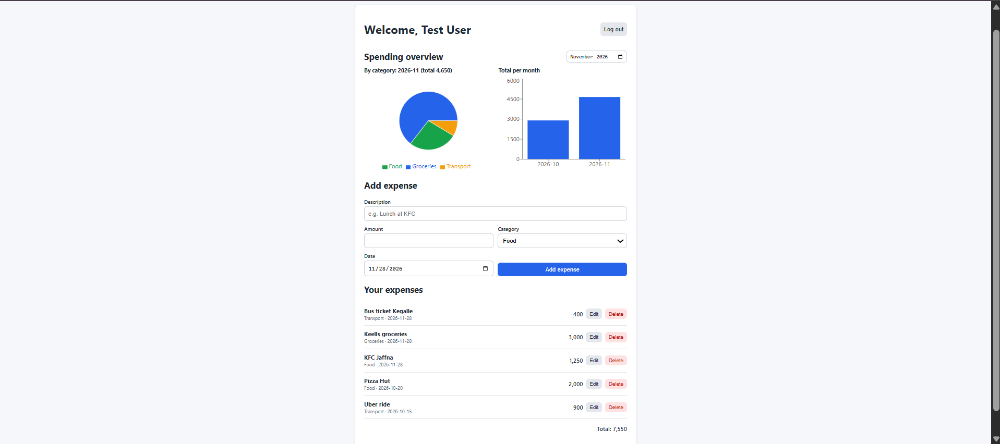

# SpendWise

A full-stack expense tracker with ML-powered insights. **Work in progress.**



Users log their expenses and see where their money goes. A separate Python service will add automatic categorization, spending forecasts and anomaly detection.

## Status

- [x] User registration and login (JWT authentication, bcrypt-hashed passwords)
- [x] Expense API: add, list, update and delete (each user only sees their own)
- [x] Summary API: spending per category and per month, for dashboard charts
- [x] React frontend: login and register, protected dashboard, add/edit/delete expenses, category and monthly charts
- [ ] ML service (Python, FastAPI): auto-categorization from transaction text
- [ ] ML service: monthly spending forecast per category
- [ ] ML service: anomaly detection
- [ ] Deployment (Railway)
- [ ] Mobile app (React Native)

## Tech stack

| Part | Technology |
|---|---|
| Frontend | React (Vite), React Router, Recharts |
| Backend API | Node.js, Express |
| Database | MongoDB Atlas, Mongoose |
| Auth | JSON Web Tokens, bcryptjs |
| ML service (planned) | Python, FastAPI |

## Project structure

```
spendwise/
├── client/       React frontend
│   └── src/
│       ├── pages/        Login, Register, Dashboard
│       └── components/   Charts, ProtectedRoute
├── server/       Express REST API
│   ├── middleware/   JWT auth check
│   ├── models/       User and Expense schemas
│   └── routes/       auth and expenses endpoints
├── docs/         Screenshots
└── ml-service/   Python ML service (planned)
```

## API reference

All `/api/expenses` routes need the header `Authorization: Bearer <token>`. Get a token from the login endpoint.

| Method | Endpoint | Description |
|---|---|---|
| POST | `/api/auth/register` | Create an account (`name`, `email`, `password`) |
| POST | `/api/auth/login` | Log in, returns a JWT and the user |
| POST | `/api/expenses` | Add an expense (`amount`, `description`, optional `category`, `date`) |
| GET | `/api/expenses` | List your expenses, newest first |
| GET | `/api/expenses/summary?month=2026-11` | Totals per category for a month, plus totals per month |
| PUT | `/api/expenses/:id` | Update an expense |
| DELETE | `/api/expenses/:id` | Delete an expense |

Example summary response:

```json
{
  "month": "2026-11",
  "monthTotal": 4650,
  "byCategory": [
    { "category": "Groceries", "total": 3000, "count": 1 },
    { "category": "Food", "total": 1250, "count": 1 }
  ],
  "byMonth": [
    { "month": "2026-10", "total": 2900, "count": 2 },
    { "month": "2026-11", "total": 4650, "count": 3 }
  ]
}
```

## Running locally

You need Node.js and a free MongoDB Atlas cluster.

```bash
git clone https://github.com/yuhansa-desilva/spendwise.git
cd spendwise
```

### 1. Backend

```bash
cd server
npm install
```

Create a file named `.env` in the `server` folder (see `.env.example`):

```
PORT=5000
MONGODB_URI=your_mongodb_connection_string_here
JWT_SECRET=your_jwt_secret_here
```

Start it:

```bash
node index.js
```

The API runs at `http://localhost:5000`.

### 2. Frontend

In a second terminal:

```bash
cd client
npm install
```

Create a file named `.env` in the `client` folder (see `.env.example`):

```
VITE_API_URL=http://localhost:5000
```

Start it:

```bash
npm run dev
```

Open `http://localhost:5173`, register an account, and start adding expenses.